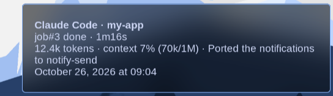
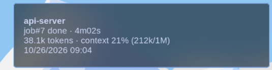

# ccnotify-omarchy

Desktop notifications for Claude Code on Arch Linux + Hyprland ([Omarchy](https://omarchy.org)), alerting you when Claude needs your input or completes tasks.

This is a Linux port of [dazuiba/CCNotify](https://github.com/dazuiba/CCNotify) (macOS). All credit for the original idea and implementation goes to its authors. This fork swaps `terminal-notifier` for `notify-send` and uses `hyprctl` for click-to-focus.
## Important Notes
Starting from claude-code v1.0.95 (2025-08-31), any invalid settings in `~/.claude/settings.json` will disable hooks. See [Why not working](#why-not-working) for solutions.

## Features

- 🔔 **Get notified** when Claude requires your input or completes a task.
- 🔗 **Click to jump back**: clicking the notification focuses the terminal window running that Claude session (Hyprland).
- ⏱️ **Task Duration**: Displays started time, and how long the task took to complete
- 🎛️ **Customizable**: pick the title, which lines to show, the date format, token usage, context usage and a short summary of what was done (see [Customization](#customization))

**Note**: This fork targets Linux (Arch Linux + Hyprland, e.g. Omarchy). Notifications go through `notify-send`, so any Freedesktop notification daemon (mako, swaync, dunst, Quickshell…) will display them. Click-to-focus requires Hyprland.


## Installation Guide

### 1. Install CCNotify
```bash
git clone https://github.com/GabrielLucre/ccnotify-omarchy.git
cd ccnotify-omarchy

# Create the directory if it doesn't exist
mkdir -p ~/.claude/ccnotify

# symlink ccnotify.py into the directory (git pull keeps it up to date)
ln -sf "$PWD/ccnotify.py" ~/.claude/ccnotify/ccnotify.py

chmod a+x ~/.claude/ccnotify/ccnotify.py

# run this script, should print: ok
~/.claude/ccnotify/ccnotify.py

ok

```
### 2. Install dependencies
ccnotify uses `notify-send` (from `libnotify`) to send notifications:

```bash
sudo pacman -S --needed libnotify python
```

Test it manually — a notification should pop up:

```bash
~/.claude/ccnotify/ccnotify.py "Test" "Claude Code finished the task."
```

On Hyprland, clicking the notification focuses the terminal it was sent from. This works by walking up the process tree to a window listed by `hyprctl clients`, so it does not work when Claude runs inside tmux/zellij, or in terminals that serve every window from one process (e.g. `foot --server`). It also needs a notification daemon that supports actions.

### 3. Configure Claude Hooks
Add the following hooks to your Claude configuration to enable ccnotify.

If your `settings.json` already has a `"hooks"` key, don't paste a second one: merge these events into it. If an event already has hooks, append the ccnotify command to its existing `"hooks"` array. An invalid `settings.json` disables all hooks.

 ~/.claude/settings.json 
 
```json

  "hooks": {
  "UserPromptSubmit": [
    {
      "hooks": [
        {
          "type": "command",
          "command": "~/.claude/ccnotify/ccnotify.py UserPromptSubmit"
        }
      ]
    }
  ],
  "Stop": [
    {
      "hooks": [
        {
          "type": "command",
          "command": "~/.claude/ccnotify/ccnotify.py Stop"
        }
      ]
    }
  ],
  "Notification": [
    {
      "hooks": [
        {
          "type": "command",
          "command": "~/.claude/ccnotify/ccnotify.py Notification"
        }
      ]
    }
  ]
}

```

## Try It Out

To verify the notification system works, start a new Claude Code session and run:
```
after 1 second, echo 'hello'
```
You should see a desktop notification appear.

## Why not working
1. Ensure hooks configuration is active. Here's an example where other configurations prevent hooks from working:

`claude -p --model haiku -d hooks --verbose "hi"`

Expected output:

```
[DEBUG] Found 1 hook commands to execute
[DEBUG] Executing hook command: ~/.claude/ccnotify/ccnotify.py UserPromptSubmit with timeout 60000ms
[DEBUG] Hook command completed with status 0: ~/.claude/ccnotify/ccnotify.py UserPromptSubmit
```

Actual output:

```
[DEBUG] Invalid settings in userSettings source - key: permissions.allow.0, error:.....
[DEBUG] Found 0 hook commands to execute
```
Reason: In September 2025, claude-code strengthened validation rules for settings.json. Any invalid configuration will disable hooks.
You need to modify the relevant configurations in `~/.claude/settings.json` until the `Invalid settings` error stops appearing.


## Customization

Settings live in `~/.claude/ccnotify/config.json` and are managed from the terminal. Running these commands yourself does not use any Claude Code usage.

```bash
~/.claude/ccnotify/ccnotify.py config                    # show current settings
~/.claude/ccnotify/ccnotify.py config set title claude   # set one option
~/.claude/ccnotify/ccnotify.py config fields job,duration,tokens,context,summary,date
~/.claude/ccnotify/ccnotify.py config reset              # back to defaults
~/.claude/ccnotify/ccnotify.py preview                   # send a sample notification
```

| Option | Values | Default |
| --- | --- | --- |
| `title` | `project` (folder name), `claude` ("Claude Code"), `both` ("Claude Code · project") | `project` |
| `fields` | comma-separated, in display order (`date` is always last): `job`, `duration`, `tokens`, `context`, `summary`, `date` | `job,duration,date` |
| `date_format` | `long` (October 26, 2026 at 08:25), `short` (10/26/2026 08:25), `time` (08:25), `iso` (2026-10-26 08:25), or any `strftime` pattern such as `%d/%m/%Y` | `long` |
| `summary_mode` | `excerpt` (first sentence of Claude's last reply), `ai` (one-line summary written by Claude Haiku) | `excerpt` |
| `context_window` | context size in tokens used for the `context` %, `0` = auto (200k, or 1M when usage goes above 200k) | `1000000` |
| `urgency_keywords` | comma-separated words that make a notification critical | `error,fail` |
| `max_lines` | maximum body lines (the title doesn't count); the first lines and the date stay as they are, and the lines in between are packed onto one. `0` = no limit | `3` |

### Examples

| Settings | Notification |
| --- | --- |
| Defaults |  |
| `title both`<br>`fields job,duration,tokens,context,summary,date` |  |
| `fields job,duration,tokens,context,date`<br>`date_format short` |  |
| `fields job,duration,summary,date`<br>`date_format time` |  |
| `title claude`, when Claude asks for permission |  |

`job` and `duration` share a line, and so do `tokens` and `context`. With the default `max_lines 3`, the fields between the first line and the date are packed onto one line, which is why the summary follows the token count in the second example. With `max_lines 0` the summary gets its own line.

**Only 2 body lines showing?** That limit comes from your notification daemon, not from ccnotify. mako (Omarchy's default) caps a notification at 100px tall, which fits the title plus 2 lines. Raise it in `~/.config/mako/config` and run `makoctl reload`:

```ini
height=200
```

Or keep mako as it is and let ccnotify pack the body into 2 lines: `ccnotify.py config set max_lines 2`.

`tokens`, `context` and the `excerpt` summary are read from the local session transcript, so they are free. `tokens` counts the tokens processed in the last turn, not counting cache reads. `context` is how full the context window was at the end of the turn. If your model's window differs from the guess, set `context_window`.

> **Note:** `summary_mode ai` runs `claude -p --model haiku` after every task, which **uses your Claude Code usage** (a few thousand tokens per notification). It runs in the background with hooks disabled, and the notification arrives a few seconds later. If Claude can't be reached, the free excerpt is used instead.

## How It Works

ccnotify tracks Claude sessions and provides notifications at key moments:

- **When you submit a prompt**: Records the start time and project context
- **When Claude completes**: Calculates duration and sends a completion notification
- **When Claude waits for input**: Immediately alerts you that input is needed

All activity is logged to `~/.claude/ccnotify/ccnotify.log` and session data is stored in `~/.claude/ccnotify/ccnotify.db` locally. No data is uploaded or shared externally.


## Uninstall

Edit `~/.claude/settings.json` and remove all hook commands related to `ccnotify`.

Remove all files with a single command:
```bash
rm -rf ~/.claude/ccnotify
```

